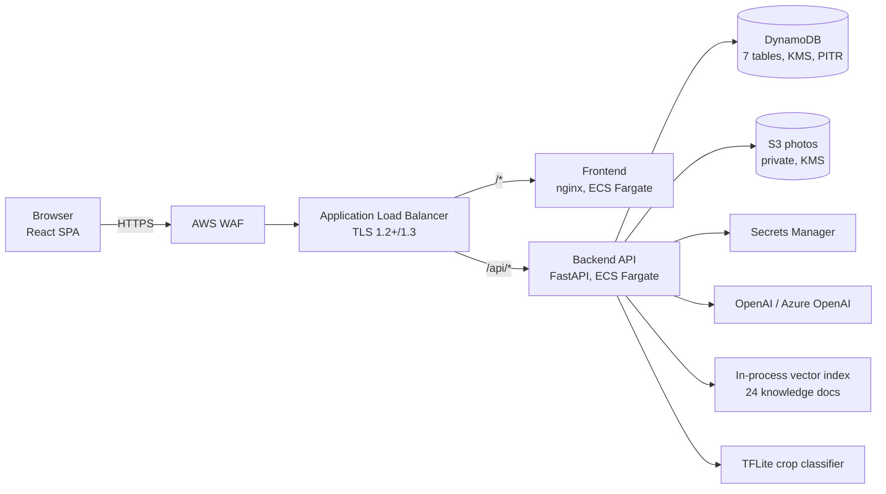

# Ameer Kisaan

An AI-assisted farming app for growers in Jharkhand: live weather, crop guides and recommendations, pest and risk help, government schemes, inventory, a community forum, issue reporting with photos, and **Kisaan AI**, an assistant that answers from the app's own crop knowledge base.

The product requirements are in [`README`](README) (the original BRD).

## Architecture



| Layer | Local (docker-compose) | AWS (infra/terraform) |
|---|---|---|
| Web app | nginx container on `localhost:3000` | ECS Fargate behind ALB + WAF |
| API | FastAPI container | ECS Fargate, private subnets, autoscaling |
| Database | DynamoDB Local | DynamoDB (KMS-encrypted, point-in-time recovery, deletion protection) |
| Photo storage | S3Proxy | S3 (private, KMS, TLS-only, versioned) |
| Secrets | `.env` | Secrets Manager, injected into the task at start |
| LLM + embeddings | Ollama (`llama3.2:1b`, `nomic-embed-text`) | OpenAI or Azure OpenAI |

Code layout:

```
src/                      React app (CRA) - root repo
src/Components/           UI components (git submodule: ameer-kisaan-frontend)
  services/api.js         API client: in-memory access token, refresh via HttpOnly cookie
src/Backend/              FastAPI API (git submodule: ameer-kisaan-backend) - see its README
infra/terraform/          AWS infrastructure
.github/workflows/        CI (tests, scans, validate) and manual OIDC deploy
docker-compose.yml        Full local stack
```

## Run it locally

Requirements: Docker Desktop (about 6 GB free disk for the local LLM).

```bash
cp .env.example .env
# Fill in JWT_SECRET and FIELD_ENCRYPTION_KEY in .env using the two commands at the top of that file
docker compose up --build
```

Open http://localhost:3000 and register. The first start downloads the Ollama models (~1.6 GB). Until that finishes, Kisaan AI replies "temporarily unavailable" and everything else works.

Make yourself an admin (to review issue reports and moderate the forum):

```bash
docker compose exec backend python scripts/create_admin.py you@example.com
```

Frontend-only development with hot reload: run the stack, then `npm start`. It proxies `/api` to `localhost:8000`, so also add `ports: ["127.0.0.1:8000:8000"]` to the backend service.

## Train the crop classifier

The "Identify crop" button uses a model trained on `src/Components/Agricultural-crops` (30 crops, ~830 photos):

```bash
cd src/Backend
python3 -m venv .venv-train && . .venv-train/bin/activate
pip install -r requirements-train.txt
python scripts/train_crop_classifier.py --data ../Components/Agricultural-crops --out models
docker compose restart backend
```

The script reports held-out accuracy in `models/crop_classifier.metrics.json`. With ~28 photos per crop, expect modest accuracy; adding photos is the biggest lever. These photos are of crops, not pests, so the model identifies the crop. Pest/disease detection needs a labelled pest photo set; the same script trains on any folder-per-class dataset.

## Security

| Area | What is in place |
|---|---|
| Passwords | Argon2id hashing, strength rules, common-password list, constant-time responses for unknown emails (no account enumeration by timing) |
| Sessions | 15-minute JWT access token held only in memory; 7-day refresh token in an `HttpOnly`, `Secure`, `SameSite=Strict` cookie scoped to `/api/v1/auth`, rotated on every use, with reuse detection that revokes the whole session family |
| Brute force | Per-account lockout (5 failures / 15 min), per-IP rate limits, plus WAF rate rules in AWS |
| CSRF | SameSite=Strict + required `X-Requested-With` header + CORS limited to the app's origin |
| Authorisation | Roles (`user`, `admin`); admin cannot be self-assigned; per-user data is keyed by the token's user id, so cross-user access is impossible by design |
| Sensitive IDs | Aadhaar and PAN are optional, AES-256-GCM encrypted per field, and only ever returned masked |
| Uploads | Images decoded and re-encoded server-side (EXIF/GPS stripped, non-images and decompression bombs rejected, 5 MB cap), private bucket, 15-minute presigned links |
| Input | Strict schemas with length limits; unknown fields rejected; validation errors never echo submitted values |
| AI | Prompt-injection screening, PII redaction before text reaches the LLM and in chat history, answers grounded only in retrieved passages (no context → no LLM call) |
| Headers | CSP (no inline scripts), HSTS, X-Frame-Options, nosniff, Referrer-Policy, no-store on API responses |
| Audit | Append-only audit table (IAM allows only `PutItem`); written after the response, never containing passwords, tokens or raw identifiers |
| Infrastructure | Private subnets, least-privilege IAM, KMS everywhere, read-only non-root containers with all Linux capabilities dropped, immutable scanned images, GitHub OIDC deploys (no stored AWS keys) |

The backend test suite (`cd src/Backend && pytest`) has 35 tests covering these controls.

## Free hosting (no payment card)

Production runs free on Render (web app + API in one service), Supabase (Postgres and photo storage), Groq (Kisaan AI answers) and Google AI Studio (embeddings). See [DEPLOY.md](DEPLOY.md).

## Deploy to AWS

See [`infra/terraform/README.md`](infra/terraform/README.md).
